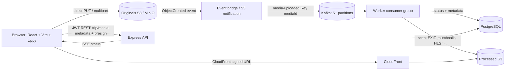

# TripVault

TripVault is a shared, invite-only trip gallery. This repository starts with a local MVP and keeps the production processing path explicit.

## Run locally

Requirements: Docker Compose and Node 20+. The database server is PostgreSQL; `psql` is the command-line client you can use to connect to it.

```sh
cp .env.example .env
docker compose up --build
```

Connect with `docker compose exec postgres psql -U tripvault -d tripvault`.

Web: http://localhost:3000 · API: http://localhost:4000/health · MinIO console: http://localhost:9001 (`minioadmin` / `minioadmin`). The compose stack provides PostgreSQL, Kafka (5 partitions), MinIO, API, and worker. Configure `DATABASE_URL`, `S3_*`, `KAFKA_BROKERS`, `JWT_SECRET` in `.env` before use. The UI/API are a scaffold; production authentication, invitation email delivery, and AWS deployment credentials must be configured before exposing it publicly.

## Architecture



Local MinIO does not natively publish Kafka events. The API emits a local event after upload completion in this scaffold; production should use S3 Event Notifications through EventBridge/SQS or a small bridge to Kafka. Keep original uploads out of API and Kafka.

```mermaid
sequenceDiagram
  actor U as Browser
  participant API as Express API
  participant DB as PostgreSQL
  participant S3 as S3 / MinIO
  participant K as Kafka
  participant W as Worker
  U->>API: POST /trips/:tripId/media (metadata)
  API->>DB: authorize trip member; insert PENDING media
  API-->>U: mediaId + upload instructions
  alt file <= 100 MB
    U->>API: POST /media/:id/upload-url
    API-->>U: presigned PUT URL
    U->>S3: PUT bytes directly (progress)
    U->>API: POST /media/:id/complete
  else file > 100 MB
    U->>API: POST /media/:id/multipart
    API-->>U: uploadId
    loop each part (resumable; persist uploadId/parts)
      U->>API: POST /media/:id/multipart/:uploadId/part-url?partNumber=n
      API-->>U: presigned part URL
      U->>S3: PUT part directly
    end
    U->>API: POST /media/:id/multipart/:uploadId/complete
  end
  API->>S3: verify object / complete multipart
  API->>K: media-uploaded {mediaId,s3Key,type}, key mediaId
  API->>DB: status PROCESSING
  API-->>U: accepted; SSE emits status changes
  K->>W: consume (at least once)
  W->>S3: read original; scan/process; write derivatives
  W->>DB: READY or FAILED
  W-->>U: status event via SSE/pubsub
```

## MVP trade-offs

For a friend/family trip with roughly 20 people, SQS + DLQ is usually simpler and cheaper than operating Kafka. Keep Kafka only when replay, multiple independent consumers, event throughput, or an existing Kafka platform justify its operational cost. The compose stack includes Kafka to exercise the requested contract; API currently publishes the completion event directly. Production S3 events should be the source of truth so an abandoned browser cannot suppress processing.

## Folder layout

```text
client/              React + Vite, Tailwind, Uppy upload UI
backend/api/         Express REST API, auth, trip access, presigning, Kafka producer
backend/worker/      Kafka consumer, scanner hook, image/video processing
 db/schema.sql  PostgreSQL schema + indexes
 infra/          Terraform deployment starter
```

## REST contract

All `/api` routes except signup/login/health require `Authorization: Bearer <JWT>`. Every trip-scoped route checks `trip_members` membership; only owners manage members and trip settings.

| Method | Path | Purpose |
|---|---|---|
| POST | `/api/auth/signup` | Create account `{email,password,name}` |
| POST | `/api/auth/login` | Login `{email,password}` → `{accessToken}` |
| POST | `/api/trips` | Create trip `{title,location,startDate,endDate,description}` |
| GET | `/api/trips` | List trips with role, cover URL, media counts, member count |
| GET | `/api/trips/:tripId` | Trip detail with media counts and member count |
| PATCH | `/api/trips/:tripId` | Owner updates trip info `{title,location,startDate,endDate,description}` |
| DELETE | `/api/trips/:tripId` | Owner deletes the trip, its media rows, and stored objects |
| POST | `/api/trips/:tripId/invitations` | Owner invites `{email,role}` → invite URL/token |
| POST | `/api/trips/join/:token` | Accept invite |
| POST | `/api/trips/:tripId/media` | Create PENDING row `{filename,mimeType,size,caption,takenAt,location}` → `{mediaId}` (images, video, and audio) |
| POST | `/api/media/:id/upload-url` | Small object presign → `{url,method,headers,expiresIn}` |
| POST | `/api/media/:id/multipart` | Initiate S3 multipart → `{uploadId,partSize}` |
| POST | `/api/media/:id/multipart/:uploadId/part-url` | `{partNumber}` → `{url}` |
| POST | `/api/media/:id/multipart/:uploadId/complete` | `{parts:[{partNumber,etag}]}` complete + enqueue |
| POST | `/api/media/:id/complete` | Confirm small upload, enqueue |
| GET | `/api/trips/:tripId/media?day=&uploaderId=&cursor=` | Gallery metadata |
| GET | `/api/media/:id/download-url` | Short-lived CloudFront signed URL |
| POST/DELETE | `/api/media/:id/likes` | Like / unlike |
| GET/POST | `/api/media/:id/comments` | List / add comment `{body}` |
| GET | `/api/trips/:tripId/events` | SSE processing status stream |

Small upload example:

```json
POST /api/trips/uuid/media
{"filename":"beach.jpg","mimeType":"image/jpeg","size":2451000,"caption":"Sunset","takenAt":"2026-06-12T18:30:00Z","location":"Goa"}
→ {"mediaId":"uuid","status":"PENDING"}
```

## Database

See [`db/schema.sql`](db/schema.sql). It includes membership, invitation, media status, comments, likes, constraints, and query indexes. `trip_members` is the single authorization source.

## Where media is stored

The app never stores image, video, or audio bytes in PostgreSQL. The database stores metadata and object keys only:

- Browsers upload bytes **directly** to the originals bucket (`S3_ORIGINALS_BUCKET`, default `tripvault-originals`) using a short-lived presigned URL.
- Original object key: `<tripId>/<mediaId>/original`. The `media.s3_key` column records this key.
- Image previews are generated by the worker and written to the processed bucket (`S3_PROCESSED_BUCKET`, default `tripvault-processed`) at `<mediaId>/preview.webp`. `media.processed_key` records this key.
- Video and audio files currently play directly from the originals bucket. When an ffmpeg/HLS pipeline is added, its derivative keys will also live in the processed bucket and be stored in `processed_key`.
- The browser never gets bucket credentials. `GET /api/trips/:tripId/media` returns short-lived presigned URLs, and deleting a trip removes its objects from both buckets on a best-effort basis.

Locally, MinIO stores the bytes in the Docker volume `miniodata` (container path `/data`). You can inspect them in the MinIO console at http://localhost:9001 (`minioadmin` / `minioadmin`) or from the CLI:

```sh
# List stored objects (works with the compose aws-cli init container)
docker compose run --rm --entrypoint /bin/sh minio-init -c \
  'export AWS_ACCESS_KEY_ID=minioadmin AWS_SECRET_ACCESS_KEY=minioadmin; \
   aws --endpoint-url http://minio:9000 s3 ls s3://tripvault-originals/ --recursive'

# See the database metadata that points at those objects
docker compose exec postgres psql -U tripvault -d tripvault \
  -c "select id, trip_id, filename, mime_type, s3_key, processed_key, status from media order by created_at desc;"
```

In production, point `S3_ENDPOINT`/`S3_PUBLIC_ENDPOINT` at AWS S3 and place CloudFront in front of the processed bucket. Only the endpoint and credentials change; the API/worker storage logic stays the same.

## Kafka contract

- `media-uploaded`: 5 partitions minimum; key is `mediaId`; payload `{mediaId,s3Key,type}` (small, no file data).
- Consumer group: `tripvault-processors`; scale workers horizontally. Processing is idempotent on `mediaId` and output keys.
- Retry: transient errors retry with exponential backoff (1s, 5s, 30s, then delayed retry topic); cap attempts at 5. Permanent validation/malware errors go directly to `media-uploaded-dlq`; exhausted transient events go there with error and attempt metadata.
- DLQ retains original event, failure code/message, attempt count, and timestamp; alert and provide safe replay tooling. Commit offsets only after DB status/output writes.

## Security and operations

- JWT short expiry + refresh rotation; Argon2id password hashes; verified email and invitation tokens hashed at rest, single-use, expiring.
- Enforce membership on every object/media/comment access. Validate magic bytes (not just extension), allowlist image/video/audio MIME, cap at 2 GB, rate-limit, and use random object keys. Never accept client-supplied S3 keys.
- Hook ClamAV or a managed scanner before processing/serving. Quarantine originals until scan passes. Escape captions/comments and apply CSP.
- Private buckets, Block Public Access, SSE-KMS, TLS-only bucket policy, least-privilege API/worker IAM, separate original and derivative buckets. CloudFront OAC to processed bucket; signed URLs/cookies with short TTL. CORS only the app origin and required PUT headers; never wildcard credentials.
- SSE event stream is authenticated and trip-authorized; use Redis/pubsub across API replicas. Persist status in Postgres to recover dropped events.
- Monitor upload failures/latency, Kafka lag, retries/DLQ volume, processing duration, READY/FAILED rates, S3 bytes/requests, CloudFront egress, DB connections, and SSE disconnects. Add structured logs with mediaId/traceId, metrics, and alerts.
- Back up Postgres with PITR; define retention/deletion lifecycle and verify restore. S3 lifecycle can transition old originals to cheaper tiers.

## Cost and scale notes

At 20 members × 5,000 items, storage and especially video delivery dominate; cost depends on average file size, retention, and viewer traffic. As an illustration only: 25,000 items averaging 8 MB is about 200 GB originals; 2 GB average video would instead be ~50 TB. AWS S3 Standard storage is roughly $0.023/GB-month in common US regions (~$5/month for 200 GB), while CloudFront egress, requests, transcoding, and backups can exceed storage. Get region-specific current pricing before launch. Use lifecycle policies, generated thumbnails, adaptive HLS, and CloudFront caching. Kafka is disproportionate for low upload rates; start with SQS Standard + DLQ and idempotent workers, then migrate if replay/multiple consumer needs emerge.

## Roadmap

1. MVP: auth, trip/member authorization, direct uploads to MinIO/S3, gallery, statuses, basic image thumbnails, comments/likes.
2. Harden: invite links/email verification, resumable multipart persistence, EXIF timezone handling, scanner quarantine, signed delivery, SSE.
3. Media: ffmpeg HLS/MP4 variants, poster frames, video seeking, background retries and DLQ replay.
4. Production: AWS Terraform, CloudFront OAC, KMS, backups, rate limiting, observability, lifecycle and deletion controls.
5. Scale only as needed: SQS → Kafka, Redis pubsub, CDN tuning, worker autoscaling.

### MVP limits to close before launch

The API includes signup/login (scrypt password hashing), trip creation, membership-gated media creation, presigning, and multipart completion. Image uploads get a WebP preview; video and audio uploads are verified and marked READY with the original served directly until an ffmpeg/HLS transcoder is configured. This first slice still has no CloudFront signer, EXIF extraction, or production-grade retry scheduler. The UI is a design-forward trip gallery with a hero-first home page and trip cards (cover, dates, media counts, member count). Selecting a card navigates to a dedicated `/trips/:id` page with the trip’s info and media gallery, while the home page stays focused on the hero and trip list. The Uppy upload panel accepts photos, videos, and audio; admin-only trip edit/delete controls are gated by the app admin flag. Clicking any photo opens a full-screen viewer with previous/next navigation, keyboard arrows, swipe, and Esc to close. The invite dialog can generate a member link for any trip the admin manages via a built-in trip selector. It expects an authenticated token in browser local storage. Multipart parts are retriable by Uppy, but durable resume across browser restarts requires persisting upload IDs and completed ETags. Build the remaining pieces in roadmap order. Local MinIO CORS must allow `http://localhost:3000` PUT with Content-Type and expose ETag; point its presigned URL endpoint at a hostname reachable by both the API and browser.

The Compose API uses `S3_ENDPOINT=http://minio:9000` for server-side requests and `S3_PUBLIC_ENDPOINT=http://localhost:9000` for signed URLs returned to the browser. MinIO CORS needs to permit the local web origin and expose `ETag` for multipart completion. Create a MinIO CORS rule for `http://localhost:3000` (`PUT`, `GET`, `HEAD`, `Content-Type`, expose `ETag`) before using browser uploads.

### Use AWS S3 instead of local MinIO

The local Compose stack uses MinIO, which is an S3-compatible local service. To store trip files in AWS, create the private buckets with `infra/main.tf`, then configure the backend and worker using `.env.aws.example` (copy it to `.env` and fill in your database, broker, region, and bucket names). Leave `S3_ENDPOINT` and `S3_PUBLIC_ENDPOINT` empty so the AWS SDK uses regional S3 endpoints. In AWS, attach the `tripvault-backend` EC2 instance profile created by Terraform to the instance running the API and worker. The AWS SDK automatically reads temporary role credentials from EC2 Instance Metadata; do not configure access key or secret key variables. The API signs browser uploads directly to the originals bucket, while the worker reads originals and writes previews to the processed bucket. File bytes go directly from the browser to S3.

Terraform creates private, encrypted buckets with public access blocked and upload CORS on the originals bucket. Review the AWS region and `upload_origins` before applying. Terraform outputs the final bucket names (with the account ID suffix) for `S3_ORIGINALS_BUCKET` and `S3_PROCESSED_BUCKET`. You need AWS credentials configured before applying Terraform; no AWS buckets have been created yet.
